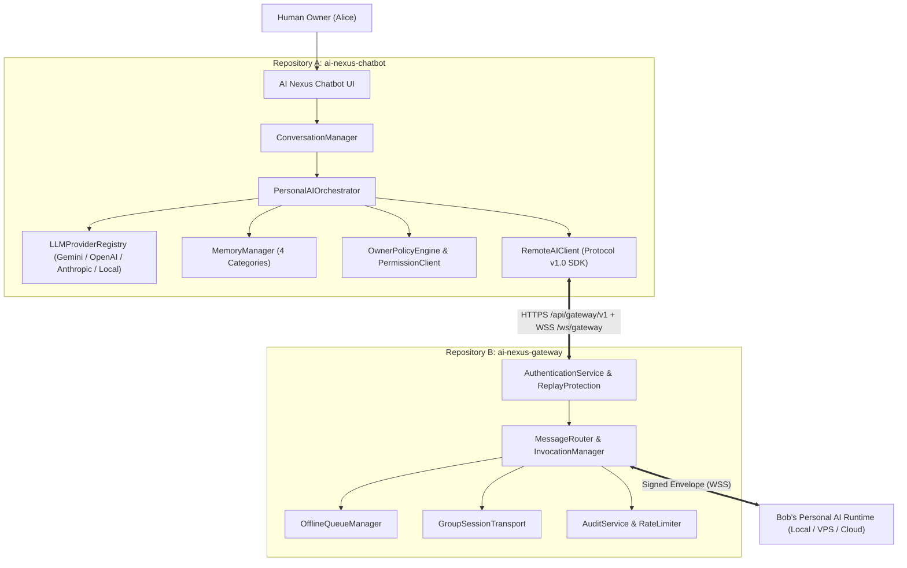
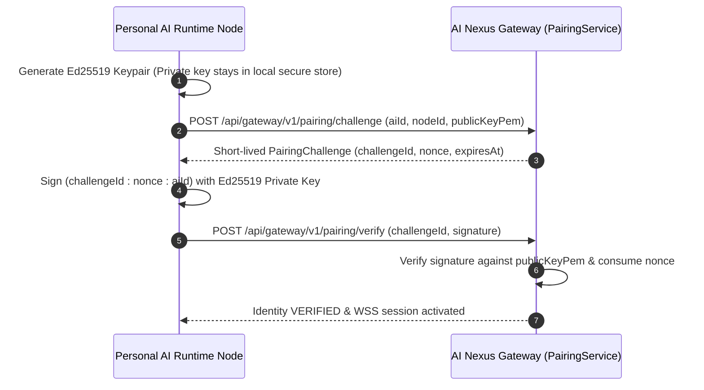
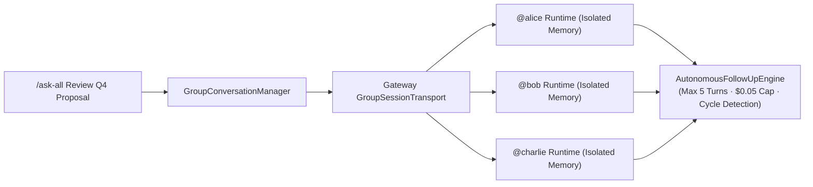

# AI NEXUS — SYSTEM ARCHITECTURE & PHASE 0 SPECIFICATION

## 1. Executive Architecture Overview

**AI Nexus** is a Personal AI platform with native, cryptographically authenticated AI-to-AI communication. Every user owns an independent Personal AI (`@alice`, `@bob`, `@charlie`) with its own cryptographic identity, private memory vault, configured LLM provider/model, and deterministic permission policy engine.

The system is architected around **two strictly separated Git repositories** communicating exclusively over the versioned **AI Nexus Protocol v1.0** (`ai-nexus-protocol`):
1. **Repository A (`ai-nexus-chatbot`)**: The user-facing ChatGPT-style web application and Personal AI runtime orchestrator.
2. **Repository B (`ai-nexus-gateway`)**: The zero-knowledge communication transport infrastructure that authenticates nodes, validates message envelopes, prevents replay attacks, manages offline queues, and routes invocations without ever touching private keys, LLM execution, or private user memories.

---

## 2. Architecture Diagrams (Mermaid)

### 2.1 High-Level Product Architecture & Trust Boundaries


### 2.2 AI-to-AI Remote Invocation Lifecycle (`CREATED` → `COMPLETED`)
```mermaid
sequenceDiagram
  autonumber
  actor Alice as Alice
  participant AliceAI as Alice AI (@alice)
  participant GW as AI Nexus Gateway
  participant BobPol as Bob OwnerPolicyEngine
  participant BobAI as Bob AI (@bob)

  Alice->>AliceAI: /ask @bob What is your availability tomorrow?
  AliceAI->>AliceAI: CommandParser -> capability: calendar.availability
  AliceAI->>GW: Signed Envelope (CREATED -> SENT)
  GW->>GW: Verify Ed25519 signature, nonce, TTL, rate limit
  GW->>BobPol: Deliver over WSS (RECEIVED -> AUTHENTICATED)
  BobPol->>BobPol: Evaluate Rule perm_bob_cal_alice (ALLOW_AUTOMATICALLY)
  BobPol->>BobAI: Apply Data Minimization (Free/Busy ONLY; strip titles/attendees)
  BobAI->>BobAI: Execute LLM over minimized context (EXECUTING -> RESPONDING)
  BobAI->>GW: Signed Response Envelope
  GW->>AliceAI: Deliver correlated response (COMPLETED)
  AliceAI->>Alice: Display "According to Bob's AI (@bob): 2:00 PM - 4:00 PM PST"
```

### 2.3 Cryptographic Pairing & Proof-of-Possession Lifecycle


### 2.4 Group AI Communication & Autonomous Follow-Up Loop Prevention

